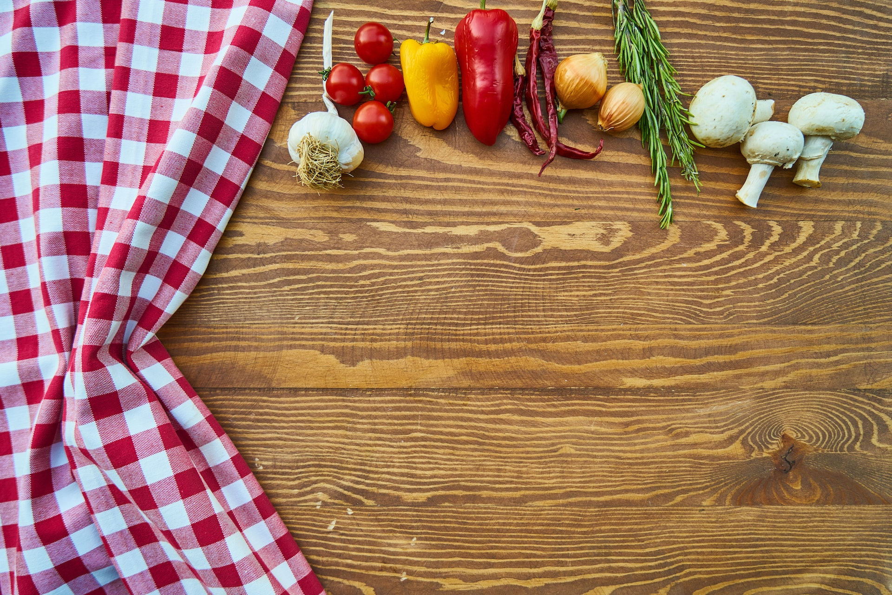
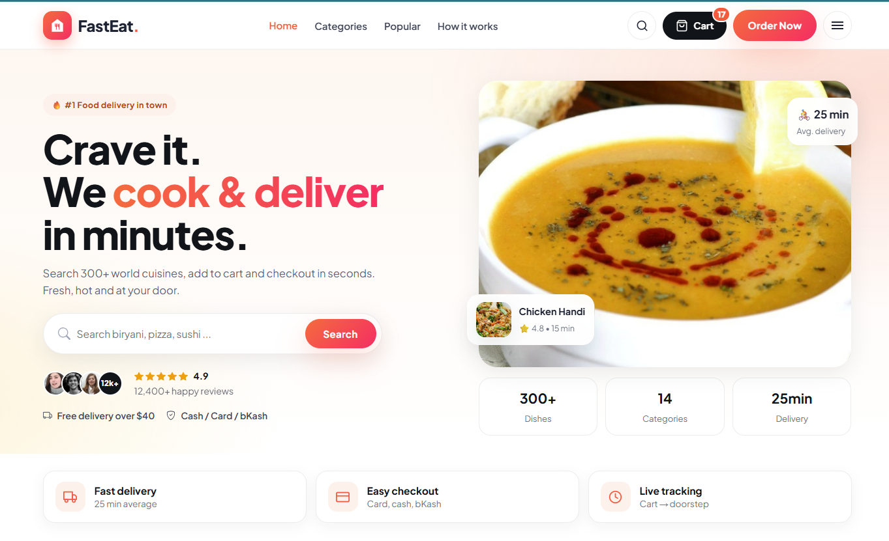

# 🍔 FastEat — React Food Ordering Website

<p align="center">
  
</p>

<p align="center">
  
  
  
  
  
</p>

<p align="center">
  Hot, fresh & fast food ordering UI — search 300+ meals, add to cart, checkout in under a minute. ⚡
</p>

---

## ✨ Features

| Area | What you get |
|------|--------------|
| 🏠 **Beautiful home** | Hero with live search, ratings, stats, trust cards, categories, popular meals, offer banner, how-it-works |
| 🍲 **Meals** | Category browse, meal details (ingredients, measures, instructions), search results |
| 🛒 **Cart** | Add from card/details, qty stepper, remove, clear, subtotal + delivery + tax, free delivery over $40, localStorage persist |
| 💳 **Checkout** | Address validation, Cash / Card / bKash, order summary, success screen with order ID |
| 📱 **Responsive** | Mobile-first hero search, tablet-safe navbar, 1→2→3→4 column card grids |
| 🔽 **Load more** | Meal grids render 8 at a time with `Load more (X remaining)` |

## 📸 Screenshots



## 🛠 Tech stack

| Package | Version | Why |
|---------|---------|-----|
| `react` / `react-dom` | `^18.3.1` | UI |
| `react-router-dom` | `^6.30.6` | Routing (`/`, `/meal/:id`, `/meal/category/:name`, `/cart`, `/checkout`) |
| `axios` | `^1.20.0` | ThemealDB API client (`src/api/axios.js`) |
| `sass` | `^1.105.2` | SCSS styling |
| `react-icons` | `^4.12.0` | Icons |
| `react-scripts` | `5.0.1` | CRA build tooling |
| `web-vitals`, testing libs | — | Perf + tests |

Data: [ThemealDB API](https://www.themealdb.com/api/json/v1/1/) — no key needed.

## 🚀 Getting started

**Prereqs:** Node 18+ recommended (`node -v`), npm 9+.

```bash
# 1. clone
git clone <your-repo-url>
cd React-Food-Website

# 2. install
npm install

# 3. run dev server
npm start
# → http://localhost:3000

# 4. production build
npm run build
```

## 🧭 Routes

| Path | Page | File |
|------|------|------|
| `/` | Home (hero + popular + categories) | `src/pages/HomePage/HomePage.js` |
| `/meal/:id` | Meal details + add to cart | `src/pages/MealDetailsPage/` |
| `/meal/category/:name` | Category meals | `src/pages/CategoryPage/` |
| `/cart` | Cart + summary | `src/pages/CartPage/` |
| `/checkout` | Checkout + success | `src/pages/CheckoutPage/` |
| `*` | 404 | `src/pages/ErrorPage/` |

## 🗂 Project structure

```
src/
├── actions/        # API calls (categories, single meal, by category, search)
├── api/axios.js    # baseURL → themealdb
├── assets/images/  # hero image, loader
├── components/
│   ├── Header/     # Navbar + styles (hero lives here too)
│   ├── Hero/       # Homepage hero + search
│   ├── Meal/       # MealCard, MealList (+load more), MealSingle
│   ├── Category/   # CategoryList cards
│   ├── Cart* / Checkout* via pages
│   ├── Sidebar/    # mobile drawer (Home/Cart/Checkout + categories)
│   ├── Footer/     # dark footer + newsletter
│   └── Loader/ NotFound/
├── context/
│   ├── mealContext.js   # categories/meals/meal state
│   ├── cartContext.js   # cart + totals + localStorage
│   └── sidebarContext.js
├── pages/          # Home, MealDetails, Category, Cart, Checkout, Error
├── reducers/       # mealReducer, sidebarReducer
└── utils/
    ├── constants.js # API endpoints
    └── pricing.js   # deterministic price per meal
```

## 🧠 Key logic

**Pricing** (`src/utils/pricing.js`) — ThemealDB has no prices, so each meal gets a stable price from its ID:

```js
price = 7.99 + ((id % 23) * 1.15) + ((id % 7) * 0.6) + ((id % 5) * 0.4)
```

**Cart totals** (`src/context/cartContext.js`):

```
subtotal = Σ price × qty
delivery = subtotal > 40 ? 0 : 2.99   (empty cart → 0)
tax      = subtotal × 8%
total    = subtotal + delivery + tax
```

Persisted in `localStorage["fasteat_cart"]`.

**Load more** (`src/components/Meal/MealList.js`): `pageSize = 8`, auto-resets on new search/category.

## 🔌 API

| Call | Endpoint | Function |
|------|----------|----------|
| Categories | `categories.php` | `startFetchCategories` |
| Search | `search.php?s=` | `startFetchMealsBySearch` |
| By category | `filter.php?c=` | `startFetchMealByCategory` |
| Single meal | `lookup.php?i=` | `startFetchSingleMeal` |

## 📜 Scripts

| Command | Action |
|---------|--------|
| `npm start` | Dev server |
| `npm run build` | Production build → `build/` |
| `npm test` | CRA jest runner |

## 🗺 Roadmap

- [ ] Real backend / payments (Stripe, SSLCommerz)
- [ ] Auth + order history
- [ ] Vite migration (faster build)
- [ ] i18n (EN / BN)

## 🤝 Contributing

1. Fork → branch (`feat/my-change`)
2. `npm install && npm start`
3. Commit with clear message → PR

## 📄 License

MIT — free for personal & commercial use. If you use theThemealDB images/data, credit [ThemealDB](https://www.themealdb.com/).

---

<p align="center">Made with ❤️ for foodies — <b>FastEat.</b></p>
